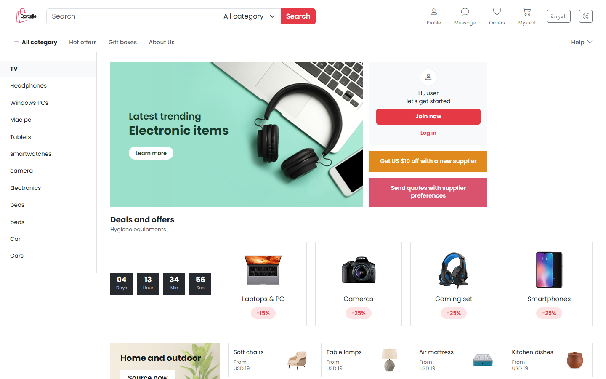
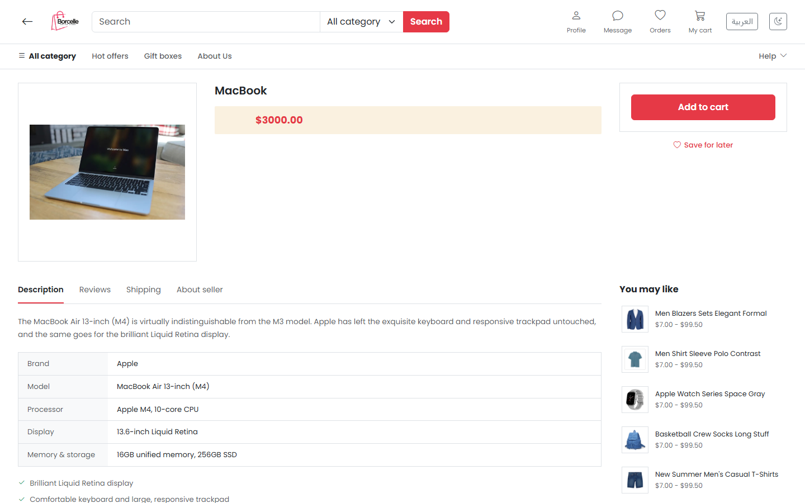
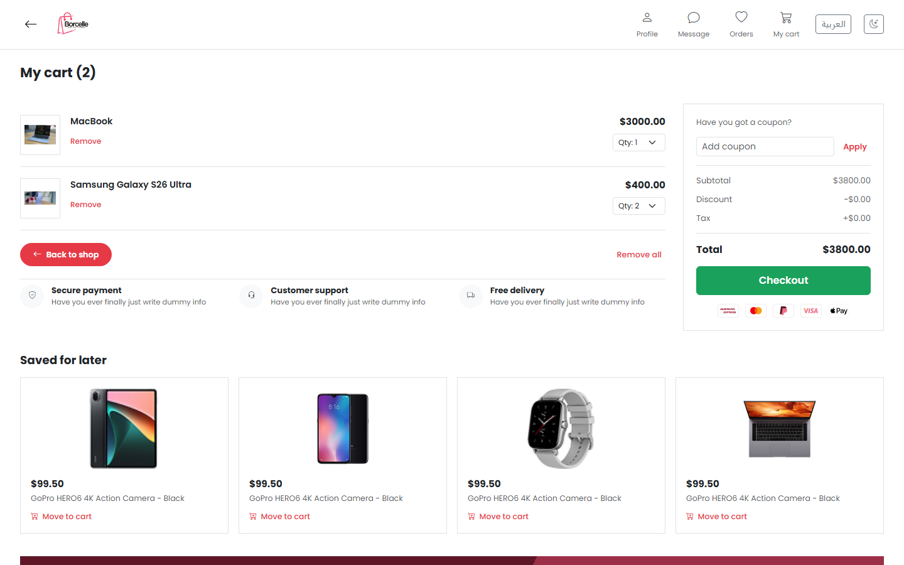
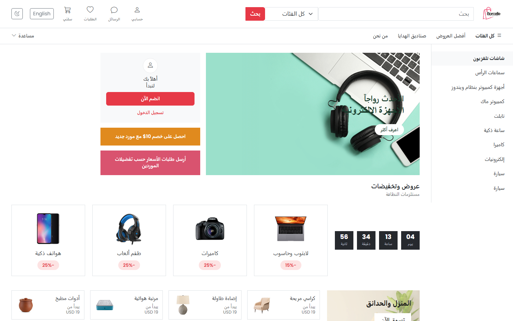
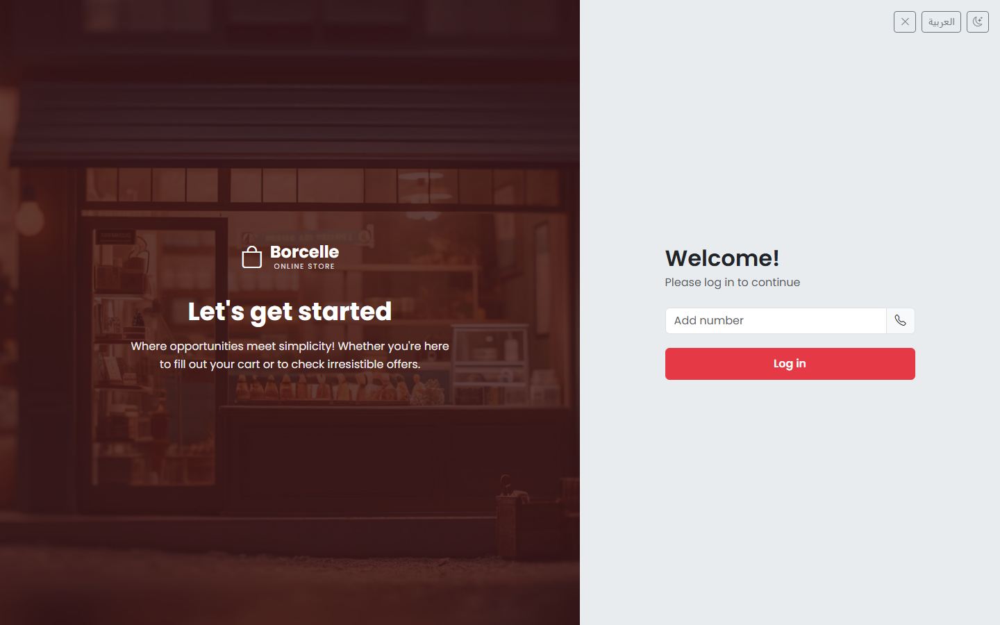
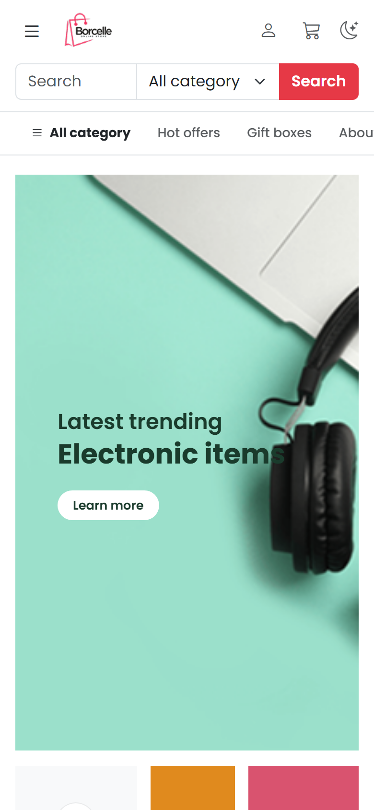

# Borcelle Online Store

A storefront for electronics, built with React and Vite during the Tamkeen training program. Products, categories, the cart, orders and accounts all come from the Tamkeen training API.



## Screenshots

| Product page | Cart |
| --- | --- |
|  |  |

| Arabic (right to left) | Login |
| --- | --- |
|  |  |

<p align="center">
  
</p>

## Features

- Browse products on the home page and open a product page with specs and features.
- Guest cart that works without an account, plus a shopping bag in the navbar.
- Phone number login with a one-time code, then profile, address and checkout.
- Payment by cash, Syriatel Cash or MTN Cash.
- Order history and account settings.
- English and Arabic, with full right-to-left layout.
- Light and dark themes.
- Works on phones, tablets and desktops.

## Tech stack

- React 19
- Vite
- React Router
- Bootstrap 5 and Bootstrap Icons
- i18next

## Getting started

You need Node.js 20.19 or newer.

```bash
git clone https://github.com/halarai2006-del/tamkeen.project.git
cd tamkeen.project
npm install
cp .env.example .env
npm run dev
```

Then open the address Vite prints, usually `http://localhost:5173`.

### Demo login

To try checkout without a real SMS code, log in with any phone number and enter `11111` as the code. Demo sessions keep the cart, addresses and orders in the browser only.

## Scripts

| Command | What it does |
| --- | --- |
| `npm run dev` | Start the development server |
| `npm run build` | Build for production into `dist` |
| `npm run preview` | Serve the production build locally |
| `npm run lint` | Check the code with oxlint |

## Project structure

```
src/
  api/          Requests to the store API
  cart/         Cart logic shared by the bag and the cart page
  components/   Navbar, mobile menu, shopping bag
  context/      Auth and theme state
  i18n/         English and Arabic translations
  pages/        One folder per page
  utils/        Helpers such as money formatting and demo mode
```
